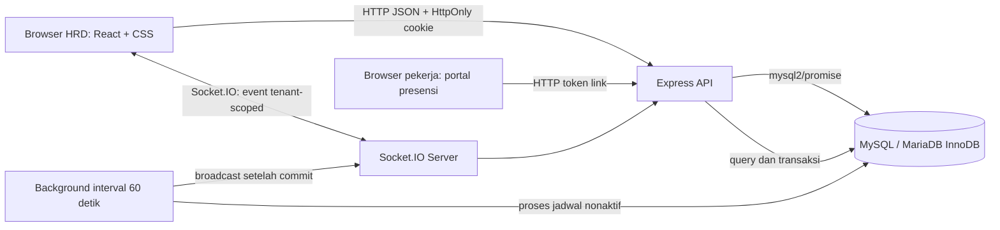

# Spesifikasi & Dokumentasi Teknis Menyeluruh

**rusakparah.web.id**  
Dokumen untuk developer, maintainer, dan operator teknis  
Versi dokumen: 1.0 · Diperbarui: 25 Oktober 2026

> Dokumen ini mendeskripsikan implementasi yang ada pada workspace saat ini. Istilah “ERNMySQL” pada kebutuhan dipetakan ke basis data MySQL/MariaDB yang digunakan backend. Perbedaan dari permintaan atau batasan implementasi ditandai secara eksplisit, bukan diasumsikan sudah tersedia.

## Daftar Isi

1. [Ruang Lingkup dan Status Implementasi](#1-ruang-lingkup-dan-status-implementasi)
2. [Arsitektur Sistem](#2-arsitektur-sistem)
3. [Tech Stack](#3-tech-stack)
4. [Struktur Proyek](#4-struktur-proyek)
5. [Alur Request dan Sinkronisasi](#5-alur-request-dan-sinkronisasi)
6. [Model Data MySQL/MariaDB](#6-model-data-mysqlmariadb)
7. [API, Sesi, dan Autentikasi](#7-api-sesi-dan-autentikasi)
8. [Role-Based Access Control](#8-role-based-access-control)
9. [Alur Domain Pekerja dan Dokumen](#9-alur-domain-pekerja-dan-dokumen)
10. [Presensi, Geofence, dan Approval](#10-presensi-geofence-dan-approval)
11. [Anti-Mock Location](#11-anti-mock-location)
12. [Socket.IO Real-Time Sync](#12-socketio-real-time-sync)
13. [Otomatisasi Tanggal Nonaktif](#13-otomatisasi-tanggal-nonaktif)
14. [Impor dan Ekspor Excel](#14-impor-dan-ekspor-excel)
15. [Audit Trail dan Observabilitas](#15-audit-trail-dan-observabilitas)
16. [Konfigurasi dan Menjalankan Lokal](#16-konfigurasi-dan-menjalankan-lokal)
17. [Validasi, Batasan, dan Pertimbangan Produksi](#17-validasi-batasan-dan-pertimbangan-produksi)
18. [Referensi Source dan Kontrak](#18-referensi-source-dan-kontrak)

## 1. Ruang Lingkup dan Status Implementasi

Aplikasi mengelola data tenant perusahaan untuk:

- siklus status pekerja `offered` → `preactive` → `active` / `inactive`;
- katalog dokumen dan evaluasi kelayakan;
- presensi harian, pengajuan, geofence, serta persetujuan;
- dashboard, riwayat aktivitas, dan pengaturan tenant;
- portal presensi pekerja melalui link bertoken.

Frontend dan backend merupakan dua aplikasi terpisah yang berkomunikasi melalui HTTP API JSON dan Socket.IO. Database adalah MySQL/MariaDB dengan InnoDB. Sesi aplikasi memakai cookie HttpOnly bertanda tangan JWT.

### Koreksi terhadap istilah/permintaan

- **Styling bukan Tailwind CSS.** Implementasi frontend menggunakan CSS biasa yang berada pada `frontend/src/styles.css`; belum ada dependency Tailwind atau konfigurasi Tailwind.
- **State management lokal.** Workspace React memakai `useState`, `useEffect`, `useMemo`, dan `useRef`; belum ada Redux, Zustand, Context store global, atau cache/query library.
- **“ERNMySQL” bukan nama engine dependency di kode.** Backend memakai `mysql2/promise` untuk koneksi ke MySQL atau MariaDB yang dikonfigurasi melalui environment.
- **Real-time menggunakan Socket.IO**, bukan WebSocket API native. Socket.IO dapat berkomunikasi lewat WebSocket dan fallback transport Engine.IO.
- **Event bukan perubahan state database yang direplikasi.** Event hanya memberi sinyal perubahan; klien membaca ulang data melalui endpoint API yang tetap menegakkan autentikasi/RBAC/tenant scope.
- **Penjadwalan bukan cron eksternal.** Backend memakai `setInterval` setiap 60 detik dan menjalankan pemrosesan sekali saat startup.

## 2. Arsitektur Sistem



### Komponen dan tanggung jawab

1. **React SPA**
   - Mengelola sesi tampilan, tab aktif, filter, formulir, pilihan tema dan data yang sedang ditampilkan.
   - Mengambil data dari API Express dengan `fetch` dan `credentials: 'include'`.
   - Menggunakan Socket.IO client untuk mendengar event tenant dan memicu fetch ulang.
   - Memproses workbook Excel di browser; file workbook tidak dikirim sebagai file ke backend.
2. **Express API**
   - Menyediakan autentikasi, validasi request, aturan transisi, RBAC, query tenant-scoped, dan operasi database.
   - Menyediakan endpoint publik terbatas untuk portal pekerja yang memvalidasi token presensi.
   - Memancarkan event setelah mutasi berhasil.
3. **Socket.IO**
   - Berjalan pada HTTP server yang sama dengan Express, path default `/socket.io`.
   - Mengautentikasi handshake dengan cookie sesi dan mengalokasikan socket ke room tenant server-side.
   - Tidak mengirim payload operasional lengkap; browser melakukan fetch ulang menggunakan API.
4. **MySQL/MariaDB**
   - Menyimpan tenant, user, pekerja, dokumen, konfigurasi, presensi, link presensi, dan audit.
   - Foreign key tenant/worker menjaga keterkaitan data lintas tabel.
5. **Background interval**
   - Memindahkan pekerja yang tanggal efektif nonaktifnya jatuh tempo ke status `inactive`.
   - Mencatat status/audit dan mencabut link presensi dalam satu transaksi, kemudian memancarkan event.

### Pola konsistensi data

Perubahan data melalui API ditulis ke database sebagai sumber kebenaran. Untuk beberapa jalur penting, operasi database, status history, dan audit trail berada dalam transaksi yang sama. Setelah commit, Socket.IO mengirim event perubahan. Klien menerima event dan mengambil representasi data terbaru melalui API.

Broadcast generic untuk API berautentikasi dijalankan pada `res.finish` jika status respons 2xx. Presensi portal anonim tidak melewati middleware tersebut; route itu memancarkan event eksplisit sesudah transaksi commit.

## 3. Tech Stack

| Lapisan | Implementasi |
|---|---|
| Runtime | Node.js; package backend mensyaratkan Node.js 20+ di README |
| Frontend | React 18, React DOM, Vite |
| Styling | CSS biasa/custom properties dan class CSS; tidak menggunakan Tailwind |
| Peta | Leaflet dan React-Leaflet; peta tile CARTO |
| Excel | ExcelJS; import/export dilakukan di browser dan library dimuat secara dinamis |
| Backend | Express 5 |
| Database driver | `mysql2/promise` |
| Database | MySQL 8+ atau MariaDB kompatibel, engine InnoDB |
| Realtime | `socket.io` server dan `socket.io-client` |
| Auth | JWT dalam cookie HttpOnly, `jsonwebtoken`, `cookie-parser` |
| Password | bcrypt melalui `bcryptjs` |
| Upload | Multer memory storage untuk foto profil dan bukti presensi |

Dependency versi aktif tercantum dalam [backend/package.json](../backend/package.json) dan [frontend/package.json](../frontend/package.json).

## 4. Struktur Proyek

```text
workspace/
  master-directives.md
  panduan-pengguna.md
  spesifikasi-teknis.md
backend/
  src/
    app.js                 # Express routes, auth/RBAC, Socket.IO, scheduler
    db.js                  # pool MySQL, bootstrap dan migrasi skema
  test/
    app.test.js            # unit test aturan/validasi backend
  docs/
    api-contract.md        # kontrak endpoint dan role
  backend-tasks.md
frontend/
  src/
    App.jsx                # SPA HRD dan local state
    Presensi.jsx           # portal pekerja
    styles.css             # CSS aplikasi; bukan Tailwind
  vite.config.js           # proxy API dan Socket.IO saat development
  frontend-task.md
```

## 5. Alur Request dan Sinkronisasi

### Request HTTP HRD

1. Browser membuat request `/api/...` dengan cookie sesi (`credentials: 'include'`).
2. Middleware `requireAuth` memverifikasi JWT, memeriksa user aktif dan `token_version` terhadap database.
3. `req.auth` diisi dari record user database: `userId`, `tenantId`, nama, email, role, dan versi token.
4. Middleware `requireAdmin` atau `requireManager` diterapkan sesuai kebutuhan endpoint.
5. Query operasional menggunakan `tenant_id` dari `req.auth`; data tenant tidak diambil dari input bebas client.
6. Setelah mutasi berhasil, response dikirim. Middleware response-finish memancarkan event untuk grup route yang sesuai.

### Request portal pekerja

Portal pekerja menggunakan endpoint `/api/public/attendance` dengan `worker_id` dan bearer token. Backend memvalidasi link terhadap `worker_attendance_links`, worker aktif, tenant dan salt. Route tidak memakai sesi user HR. Check-In/Check-Out/pengajuan dijalankan dalam transaksi dan event publik dipancarkan sesudah commit.

### State frontend

- State tampilan disimpan lokal dalam `WorkspaceApp` dan komponen terkait.
- Saat login, frontend memuat dashboard, daftar pekerja, departemen, serta jenis dokumen.
- Saat tab Presensi aktif, frontend memuat rekap harian dan matriks bulan aktif.
- Event Socket.IO memicu pengambilan ulang dashboard/pekerja, dan bila tab yang relevan aktif, rekap presensi, setting, atau History.
- Ketika socket terputus, Socket.IO mencoba reconnect; dashboard dan History juga memakai polling berkala ketika tab aktif. Polling bukan jalur utama saat socket live.

## 6. Model Data MySQL/MariaDB

Bootstrap database berada di `backend/src/db.js`. Database dibuat bila belum ada. Tabel dibuat menggunakan `CREATE TABLE IF NOT EXISTS`; sejumlah kolom dan indeks lama diperiksa lewat `information_schema` dan ditambahkan dengan `ALTER TABLE` jika belum ada.

| Tabel | Fungsi dan relasi utama |
|---|---|
| `tenants` | Identitas perusahaan, slug, dan `subscription_plan` (`free`, `pro`, `enterprise`; default `free`). |
| `users` | User tenant, role, hash password, status aktif, `token_version`, metadata dan BLOB foto profil. |
| `workers` | Profil pekerja, kontrak, status, daftar dokumen wajib JSON dalam `LONGTEXT`, soft-delete, tanggal efektif nonaktif. |
| `departments` | Nama departemen per tenant; hash ternormalisasi untuk mencegah duplikasi. |
| `document_types` | Katalog jenis dokumen per tenant; `code` stabil, status aktif, ambang peringatan nullable. |
| `tenant_document_settings` | Ambang peringatan default perusahaan. |
| `documents` | Metadata dokumen pekerja, status dan tanggal; file dokumen bukan bagian dari model sekarang. |
| `worker_status_history` | Histori transisi status pekerja. |
| `audit_events` | Audit tenant, snapshot aktor/role, aksi, entitas, deskripsi, timestamp. |
| `tenant_attendance_settings` | Salt HMAC tenant (tidak dikirim ke browser), flag Anti-Mock Location. |
| `tenant_attendance_locations` | Koordinat/radius dan aktivitas yang diwajibkan berada pada lokasi. |
| `worker_attendance_links` | Satu link per pekerja, menyimpan hash token dan waktu revoke. |
| `attendance` | Log harian, waktu, koordinat, tipe, status approval, bukti Dinas dan soft-delete. |

### Isolasi relasional

- Sebagian besar tabel data menyimpan `tenant_id`.
- Tabel `documents`, `worker_status_history`, `worker_attendance_links`, dan `attendance` memakai foreign key gabungan `(worker_id, tenant_id)` ke worker agar referensi worker harus dari tenant sama.
- Email user menggunakan unique hash global; email pekerja unik dalam tenant melalui hash tenant-scoped.
- Log presensi aktif dibatasi satu record per worker/tanggal lewat generated column `active_attendance_date`. Record yang soft-delete menghasilkan nilai `NULL` pada generated column sehingga tanggal dapat memiliki record aktif baru.
- Sintaks generated column dipilih sesuai produk server: `PERSISTENT` untuk MariaDB dan `STORED` untuk MySQL.

### Tanggal dan waktu

Pool memakai `dateStrings: true`, big numbers dipertahankan sebagai string. Dashboard ambang masa berlaku menggunakan tanggal UTC (`UTC_DATE()`); presensi menggunakan fungsi tanggal/waktu database (`CURDATE()`, `CURRENT_TIMESTAMP`). Konfigurasi timezone database harus konsisten dengan kebijakan deployment dan portal.

### Berkas

Foto profil dan bukti Dinas disimpan sebagai BLOB di MySQL, maksimal 900 KiB setelah pemrosesan. File Excel tidak disimpan. File dokumen HR worker belum diunggah/disimpan sebagai file pada skema ini.

## 7. API, Sesi, dan Autentikasi

Kontrak endpoint terperinci tersedia pada [backend/docs/api-contract.md](../backend/docs/api-contract.md). Endpoint API berjalan di `/api`; port default 4000.

### Sesi HRD

- Login menghasilkan JWT dengan issuer `hrd-management`, durasi 8 jam, subject user, tenant ID, serta `sessionVersion`.
- JWT disimpan pada cookie `hrd_session` dengan `HttpOnly`, `SameSite=Lax`, dan `Secure` bila `NODE_ENV=production`.
- Middleware API memverifikasi tanda tangan/expiry, lalu membaca user dan membandingkan `is_active` dan `token_version`.
- Perubahan password, role, status akun atau reset password menaikkan versi token untuk mencabut sesi sebelumnya.
- Password baru 12–72 byte UTF-8 dan disimpan sebagai bcrypt hash.

### Endpoint kelompok utama

| Kelompok | Endpoint contoh | Hak umum |
|---|---|---|
| Auth/profile | `/api/auth/login`, `/api/auth/me`, `/api/profile` | Semua role terautentikasi untuk profil sendiri |
| Dashboard | `GET /api/dashboard` | Semua role |
| Paket dan kuota | `GET /api/subscription` | Semua role tenant |
| Pekerja | `GET/POST /api/workers`, `PATCH/DELETE /api/workers/:id` | Read semua; create Admin/HR Staff; destructive Admin |
| Impor pekerja | `POST /api/admin/workers/import` | Admin |
| Status pekerja | `PATCH /api/workers/:id/status` | Admin |
| Dokumen | `GET /api/document-types`, `POST /api/workers/:id/documents` | Read semua; create Admin/HR Staff |
| Pengaturan dokumen | `/api/admin/document-settings`, `/api/admin/document-types` | Admin |
| Presensi | `GET /api/attendance`, `GET /api/attendance/month` | Semua role |
| Approval/status manual | `PATCH /api/attendance/:workerId/approval`, `/status` | Admin |
| Setting presensi | `/api/admin/attendance-settings`, `/api/admin/attendance-locations` | Admin |
| Link presensi | `/api/workers/:id/attendance-link` | Create Admin/HR Staff; revoke Admin |
| Portal pekerja | `/api/public/attendance` | Bearer token link yang valid |
| Audit trail | `GET /api/history` | Admin/HR Staff |

Endpoint data memvalidasi role di backend; menyembunyikan tombol pada React hanya merupakan lapisan UX, bukan kontrol keamanan.

## 8. Role-Based Access Control

### Matriks hak akses

| Kapabilitas | Admin | HR Staff (`hr_manager`) | Viewer |
|---|---|---|---|
| Baca dashboard, pekerja, dokumen, presensi | Ya | Ya | Ya |
| Buat pekerja | Ya | Ya | Tidak |
| Impor pekerja masal | Ya | Tidak | Tidak |
| Edit/archive pekerja | Ya | Tidak | Tidak |
| Buat dokumen pekerja | Ya | Ya | Tidak |
| Archive dokumen | Ya | Tidak | Tidak |
| Ubah status worker dan jadwalkan nonaktif | Ya | Tidak | Tidak |
| Baca presensi / matriks | Ya | Ya | Ya |
| Ubah status manual / approve klaim | Ya | Tidak | Tidak |
| Buat link pekerja | Ya | Ya | Tidak |
| Revoke link pekerja | Ya | Tidak | Tidak |
| Semua tab pengaturan tenant | Ya | Tidak | Tidak |
| Profil Saya dan Keamanan | Ya | Ya | Ya |
| Baca History | Ya | Ya | Tidak |

### Enforcement di frontend

- Menu dan aksi kondisional berdasarkan `user.role`.
- Admin saja melihat tombol Edit/Delete dan impor/ekspor Excel.
- HR Staff dapat membuat pekerja/dokumen dan membaca data, namun aksi destruktif atau status Admin-only tidak tersedia.
- Viewer melihat data dalam mode baca.
- Menu Pengaturan untuk non-Admin hanya menyediakan Profil Saya dan Keamanan.
- History tidak dipaparkan kepada Viewer.

### Enforcement di backend

- `requireAuth` membentuk `req.auth` dari session cookie yang valid.
- `requireAdmin` menerima hanya role `admin`.
- `requireManager` menerima `admin` dan `hr_manager`.
- Endpoint operasi memakai middleware sesuai aksi. Role tidak pernah diterima sebagai bukti otorisasi dari body/query browser.
- Query memakai tenant ID dari `req.auth`; parameter worker/document dicek bersama tenant yang sama.
- Socket room berasal dari user/session DB, bukan room/tenant yang dipilih client.

> Implementasi yang aktual memberi HR Staff izin membuat dan membaca data operasional. Tidak ada update status siklus, edit pekerja, atau delete oleh HR Staff. Tombol admin-only juga harus tetap diperlakukan sebagai terlarang meskipun client dimodifikasi.

## 9. Alur Domain Pekerja dan Dokumen

### Status pekerja

Status disimpan sebagai enum:

```text
offered → preactive → active → inactive
   └──────────────→ inactive
preactive ────────→ inactive
inactive ─────────→ active
active ───────────→ inactive
```

Transisi yang diizinkan didefinisikan pada `ALLOWED_TRANSITIONS` dalam backend. Hanya Admin dapat mengubah status. Aktivasi dari `preactive` atau `inactive` memerlukan dokumen wajib yang semuanya valid untuk tanggal hari ini. Perhitungan kelayakan tidak otomatis mengubah status.

Data pekerja yang dihapus diarsipkan menggunakan `deleted_at`; bukan hard delete. Soft-delete worker juga mencabut link presensi aktif.

### Persyaratan dokumen

- Jenis dokumen dibuat dan dikelola per tenant. `code` menjadi identitas stabil walaupun label jenis diedit.
- Daftar dokumen wajib worker disimpan sebagai JSON pada `workers.required_document_types`.
- Catatan dokumen disimpan sebagai riwayat. Catatan terbaru untuk setiap jenis merupakan acuan kelayakan.
- Status dokumen: `pending`, `valid`, `expired`, `rejected`.
- `pending` dapat menyimpan target penyelesaian; `valid`/`expired` memakai rentang berlaku; `rejected` tidak memakai tanggal tersebut.
- Tipe legacy MCU/PKWT/SIM mensyaratkan tanggal akhir untuk lolos kelayakan. Katalog baru tidak otomatis berisi jenis bawaan.
- `document_types.warning_threshold_days` nullable; NULL mengikuti default tenant pada `tenant_document_settings`.
- Dashboard menghitung dokumen yang expired atau masuk threshold efektif per jenis.

## 10. Presensi, Geofence, dan Approval

### Link portal

- Link berisi `worker_id` dan token HMAC deterministik.
- Token dibuat dari tenant, worker, salt tenant, dan `JWT_SECRET`.
- Database menyimpan hash token; salt mentah tidak pernah dikirim ke browser.
- Link hanya valid untuk pekerja aktif dengan link tidak dicabut.
- Rotasi salt membatalkan link aktif; pekerja memerlukan link baru.

### Data presensi

`attendance` menyimpan tanggal, waktu Check-In/Check-Out, koordinat masuk/keluar, lokasi yang cocok, tipe presensi, status approval, catatan approval, bukti Dinas opsional, serta status soft-delete.

Tipe presensi termasuk reguler, Off, Izin, Cuti, Sakit, dan Dinas. Pengajuan status dan Dinas dapat memulai status approval `pending`; keputusan Admin mengubahnya ke `approved` atau `rejected`. Catatan per worker/tanggal dibatasi unique untuk record aktif.

### Geofence

- Admin mengatur satu atau beberapa lokasi dengan lintang/bujur, radius 25–5.000 meter, serta daftar aktivitas diwajibkan.
- Backend menghitung jarak dengan rumus Haversine dan memilih lokasi yang radiusnya mencakup koordinat.
- Jika suatu aktivitas diwajibkan pada setidaknya satu lokasi, posisi harus cocok dengan salah satu lokasi tersebut.
- Jika aktivitas tidak diwajibkan pada lokasi mana pun, aktivitas itu boleh dilakukan di luar geofence.
- Dinas dikecualikan dari geofence. Check-In Dinas wajib membawa bukti JPG/PNG valid; bukti disimpan di MySQL dan menunggu persetujuan.

### Dashboard dan matriks

- `GET /api/attendance?date=YYYY-MM-DD` memasok data operasional tanggal.
- `GET /api/attendance/month?month=YYYY-MM` memasok data matriks bulanan.
- Sel matriks dapat mengubah tanggal operasional harian pada frontend.
- Admin melakukan approval/status manual melalui API Admin-only.
- Angka metrik bulan berasal dari rekap matriks yang dimuat frontend.

## 11. Anti-Mock Location

Anti-Mock Location merupakan mitigasi best-effort yang dikonfigurasi per tenant melalui `tenant_attendance_settings.anti_mock_location_enabled`.

### Pemeriksaan frontend

1. Portal meminta koordinat dari browser Geolocation.
2. Jika fitur aktif, client memeriksa flag `isMocked` bila browser/perangkat menyediakan atribut tersebut.
3. Client memblokir sinyal mock, akurasi tidak valid/lebih buruk dari 1.000 meter, dan kecepatan negatif/tidak valid/di atas 300 m/s.
4. Client menyertakan `is_mocked`, `location_accuracy`, dan `location_speed` ke request presensi.

### Pemeriksaan backend

1. Backend membaca flag konfigurasi tenant setelah validasi worker dan token.
2. Ketika aktif, backend mensyaratkan flag mocked yang dapat diparse dan akurasi > 0 serta ≤ 1.000 meter.
3. Flag mocked `true`, kecepatan invalid/negatif/>300 m/s ditolak.
4. Backend membandingkan koordinat terhadap sinyal lokasi presensi sebelumnya; perpindahan yang melampaui 300 m/s ditolak.
5. Baru setelah validasi anti-mock dan aturan geofence lolos, mutasi presensi diterapkan dalam transaksi.

### Batas keamanan

Browser web tidak menyediakan device attestation GPS tepercaya; client dapat dimodifikasi dan field request dapat dipalsukan. Heuristik tidak membuktikan koordinat asli dan dapat menghasilkan false positive/false negative. Gunakan ini sebagai lapisan pencegahan, bukan jaminan anti-fraud. Penguatan memerlukan aplikasi native dengan attestation integritas perangkat dan kebijakan operasional tambahan.

## 12. Socket.IO Real-Time Sync

### Transport dan autentikasi

- Backend membuat `http.Server` dari Express lalu memasang `new Server(httpServer, ...)`.
- Path Socket.IO default `/socket.io`; CORS origin mengikuti `CORS_ORIGIN`, credentials diaktifkan.
- Frontend membuat koneksi dengan `io({ withCredentials: true })`.
- Handshake membaca cookie `hrd_session`, memverifikasi JWT issuer/expiry, lalu memeriksa keberadaan user, `is_active` dan `token_version` di database.
- Server menyimpan `userId`, `tenantId`, versi token dan waktu expiry pada `socket.data`.
- Socket bergabung ke `tenant:<tenantId>` server-side. Client tidak mengirim nama room.
- Setiap 60 detik server memeriksa user, aktivasi, versi sesi dan expiry; koneksi dicabut bila invalid. Network reconnect ditangani Socket.IO client.

### Event

| Event | Sumber perubahan umum | Reaksi frontend |
|---|---|---|
| `worker_changed` | Mutasi pekerja/status, jadwal nonaktif | Fetch ulang pekerja dan dashboard |
| `attendance_updated` | Mutasi rekap/tautan, Check-In/Check-Out | Fetch ulang pekerja/dash; rekap harian dan matriks bila tab Presensi aktif |
| `approval_updated` | Keputusan approval atau klaim baru/Dinas | Fetch ulang matriks dan data terkait |
| `documents_updated` | Mutasi dokumen/katalog | Fetch ulang pekerja/dashboard; jenis dokumen atau setting bila tab pengaturan aktif |
| `dashboard_updated` | Worker, dokumen, presensi | Fetch ulang metrik dashboard |
| `settings_updated` | Setting dokumen/presensi | Fetch ulang konfigurasi saat Pengaturan aktif |
| `user_changed` | Manajemen akun | Event tersedia untuk tenant; state user dikelola oleh fetch/sesi yang relevan |
| `history_updated` | Mutasi umum atau klaim pekerja | Fetch ulang History bila tab History aktif |
| `realtime_ready` | Handshake/room berhasil | Status server siap; koneksi client juga menampilkan indikator Live |

Payload mencakup aksi dan waktu kejadian, serta pada beberapa jalur worker ID. Payload bukan representasi lengkap record; klien tidak boleh menggunakannya sebagai sumber otorisasi atau mempercayai data privatnya.

### Urutan mutasi

**API HRD yang login:** operasi database selesai → response 2xx selesai (`res.finish`) → middleware menerbitkan event sesuai route dan event umum `history_updated`.

**Portal pekerja publik:** validasi token/geofence/Anti-Mock → transaksi mutasi + log audit → commit → publish `attendance_updated`, `dashboard_updated`, approval bila sesuai, dan `history_updated` → response.

### Catatan operasional

- Event Socket.IO default tidak persisten dan tidak memberi jaminan delivery ketika klien offline.
- Setelah reconnect frontend menjadwalkan sinkronisasi ulang; data tetap berasal dari GET API.
- Polling dashboard dan History tetap ada sebagai fallback saat tab terkait aktif.
- Satu Socket.IO server proses dan satu DB pool saat ini digunakan. Multi-instance deployment memerlukan adapter/shared pub-sub (misalnya Redis), sticky sessions/konfigurasi load balancer sesuai transport, dan pengujian tambahan.
- Ping periodic untuk validasi token memakai database. Untuk skala tinggi, pertimbangkan strategi revokasi/pub-sub/cache dengan expiry yang tetap aman.

## 13. Otomatisasi Tanggal Nonaktif

### Alur penjadwalan

1. Admin mengirim status `inactive` dengan `effective_date`.
2. Jika tanggal berada di masa depan, backend hanya menyimpan `workers.scheduled_inactive_date`; status saat itu tetap.
3. Saat startup, `applyScheduledInactivations()` langsung mencari jadwal jatuh tempo.
4. Sesudah startup, `setInterval` menjalankan fungsi itu setiap 60.000 ms.
5. Fungsi membuka transaksi, memilih worker jatuh tempo dengan `FOR UPDATE`, mengubah status ke `inactive`, mengosongkan jadwal, menulis `worker_status_history`, mencabut link aktif dan memasukkan audit `system`.
6. Setelah commit, server memancarkan `worker_changed`, `dashboard_updated`, dan `history_updated` untuk tenant terdampak.

Tugas menggunakan `setInterval(...).unref()` sehingga timer tidak menahan process shutdown. Penjadwalan bersifat idempotent secara logika karena status yang sudah `inactive` tidak dipilih lagi.

### Konsekuensi

- Ketepatan pemrosesan dibatasi interval: umumnya sampai sekitar satu menit setelah tanggal masuk saat backend aktif.
- Saat backend mati, pemrosesan tertunda sampai startup/interval berikutnya.
- Dengan lebih dari satu instance backend, tiap instance dapat menjalankan scheduler; `FOR UPDATE` dan perubahan status mengurangi risiko pemrosesan bersamaan, tetapi strategi leader/locking eksplisit diperlukan untuk operasi multi-instance yang terkontrol.
- `CURDATE()` bergantung timezone server database. Samakan timezone database dan ekspektasi tanggal efektif perusahaan.
- Bukan cron eksternal dan belum memiliki dashboard monitoring job/retry queue tersendiri.

## 14. Impor dan Ekspor Excel

### Pemrosesan client-side

- ExcelJS di-load secara dinamis menggunakan `import('exceljs')`, sehingga dependensi workbook bukan bagian awal startup aplikasi.
- Export membangun workbook/sheet **Pekerja** dan menghasilkan `.xlsx` pada browser.
- Import membaca `File` via `arrayBuffer()` dan mem-parsing workbook pada memori browser.
- Workbook tidak dikirim sebagai multipart/file dan tidak disimpan di server. Browser mengirim record hasil parsing ke endpoint Admin.
- Backend memvalidasi ulang hingga 500 record: nama/posisi, email, telepon/NIK, departemen, tanggal, kontrak, gaji, dan jenis dokumen.
- Nama/NIK/email duplikat dilewati; respons memisahkan `created`, `skipped`, dan `errors`.
- Data yang lolos disimpan worker per record menggunakan transaksi dan riwayat status.

Client-side parsing mengurangi penyimpanan file di server, tetapi bukan jaminan integritas data. Backend tetap menjadi validator akhir. File sensitif hanya boleh dipilih pada perangkat/peramban yang dikelola sesuai kebijakan perusahaan.

## 15. Audit Trail dan Observabilitas

### Audit

`audit_events` menyimpan tenant, user ID nullable, snapshot nama aktor, snapshot role, action, entity type/id, deskripsi ringkas dan timestamp. Aktor sistem untuk proses terjadwal menggunakan role `system`; portal pekerja dicatat sebagai role `worker`.

Endpoint `GET /api/history?limit=100`:

- membutuhkan sesi user HR;
- hanya menerima Admin/HR Staff melalui `requireManager`;
- membatasi data ke tenant session;
- membatasi limit maksimal 200 dan menyusun terbaru lebih dahulu.

Audit tidak dirancang menyimpan password, token presensi, bukti gambar atau hasil medis. Policy retensi/pembersihan audit perlu ditentukan sebelum produksi.

### Logging

Backend melaporkan kegagalan scheduler, validasi sesi socket, dan error tak tertangani melalui `console.error`. Belum ada structured logger, tracing terdistribusi, metrik Prometheus, dead-letter queue, atau alert operasional terintegrasi.

## 16. Konfigurasi dan Menjalankan Lokal

### Backend

Environment utama (lihat `backend/.env.example`):

| Variable | Fungsi | Default / catatan |
|---|---|---|
| `PORT` | Port HTTP API + Socket.IO | `4000` |
| `DB_HOST` | Host database | `127.0.0.1` |
| `DB_PORT` | Port database | `3306` |
| `DB_USER` | User database | `root` |
| `DB_PASSWORD` | Password database | kosong untuk default lokal |
| `DB_NAME` | Nama database | `hrd_management`; maksimal 64 karakter `[A-Za-z0-9_]` |
| `DB_CONNECTION_LIMIT` | Batas pool koneksi | `10` |
| `JWT_SECRET` | Signing secret cookie JWT dan HMAC link | Rahasia acak ≥32 karakter |
| `CORS_ORIGIN` | Origin frontend yang diizinkan | `http://localhost:5173` |
| `NODE_ENV` | Mode runtime/cookie Secure | `production` untuk produksi |

Perintah:

```powershell
cd backend
npm install
npm run dev
```

### Frontend

Frontend membutuhkan backend port 4000 untuk proxy development. `VITE_CARTO_API_KEY` dikonfigurasi untuk tile peta; batasi API key berdasarkan referrer/host di provider.

```powershell
cd frontend
npm install
npm run dev
```

Vite meneruskan `/api` serta `/socket.io` termasuk upgrade WebSocket ke `http://localhost:4000`.

### Produksi

- Sajikan frontend dan API pada origin yang kompatibel atau gunakan reverse proxy yang meneruskan `/api` dan `/socket.io` termasuk upgrade.
- Pakai HTTPS, `NODE_ENV=production`, secret kuat dan `CORS_ORIGIN` spesifik.
- Pastikan reverse proxy/load balancer mempertahankan `Upgrade`/`Connection` header dan konfigurasi transport Socket.IO.
- Jangan menyimpan `.env`, password, JWT secret, link token, atau private key di repository.

## 17. Validasi, Batasan, dan Pertimbangan Produksi

### Pemeriksaan developer

- Backend unit tests berjalan melalui `npm test` pada direktori backend.
- Backend syntax check: `node --check src/app.js`.
- Frontend production build: `npm run build` pada direktori frontend.
- Tes yang ada menguji sebagian fungsi validasi/domain dan belum menggantikan integrasi lengkap terhadap MySQL/MariaDB.

### Batasan dan pekerjaan lanjutan

Paket tenant disimpan pada `tenants.subscription_plan`; bootstrap menambahkan kolom untuk tenant lama dengan default `free`. Free memiliki batas 20 pekerja aktif non-arsip. Backend memeriksa batas pada tambah manual, impor Admin, dan transisi status ke Aktif. Pengambilan paket dan jumlah pekerja aktif melalui `GET /api/subscription`; tindakan yang melampaui batas merespons `409 WORKER_QUOTA_EXCEEDED`. Pro/Enterprise tampil sebagai belum tersedia, tanpa endpoint atau integrasi pembayaran.

1. Uji schema bootstrap/migrasi dan route penuh terhadap MySQL serta MariaDB versi deployment.
2. Tambahkan integration test isolasi tenant, RBAC endpoint, Socket.IO handshake/room, event delivery, dan transaksi.
3. Tentukan retensi audit, data koordinat, dan bukti Dinas; tambahkan job retensi bila disetujui.
4. Rancang adapter Socket.IO untuk multi-instance serta penanganan reconnect/gap event yang terukur.
5. Tambahkan observabilitas scheduler, queue/locking terdistribusi, dan kebijakan retry/alert.
6. Review keamanan cookie/CORS/CSRF sesuai topologi deployment; cookie `SameSite=Lax` dan CORS bukan pengganti seluruh pertahanan CSRF.
7. Anti-Mock web adalah heuristik, bukan bukti perangkat.
8. File dokumen pekerja belum berupa berkas upload tersimpan; model saat ini adalah metadata/status/tanggal.
9. Shift dan kalkulasi keterlambatan otomatis belum menjadi bagian model operasional.
10. Frontend menggunakan CSS custom, bukan Tailwind; bila akan migrasi, rencanakan perubahan tooling dan pemetaan class tersendiri.
11. ExcelJS menghasilkan chunk terpisah yang besar pada build; import dinamis mengurangi dampak pada initial bundle, namun ukuran unduhan workbook perlu diuji pada target jaringan/perangkat.
12. Dokumentasikan backup/restore, enkripsi database/storage, rotasi secret dan incident response sebelum produksi.

## 18. Referensi Source dan Kontrak

- `backend/src/app.js` — Express routes, autentikasi/RBAC, upload, Socket.IO dan scheduler.
- `backend/src/db.js` — schema, pool, migrasi dan relasi MySQL.
- `backend/docs/api-contract.md` — endpoint API dan kontrak role.
- `backend/README.md` — persyaratan database, environment dan deployment.
- `backend/test/app.test.js` — unit test backend.
- `frontend/src/App.jsx` — workspace React, state lokal, event client dan pemrosesan Excel.
- `frontend/src/Presensi.jsx` — portal pekerja dan validasi geolokasi client.
- `frontend/src/styles.css` — styling CSS custom.
- `frontend/vite.config.js` — development proxy API/Socket.IO.
- `frontend/README.md` — prosedur menjalankan frontend dan fitur UI.
- `workspace/panduan-pengguna.md` — panduan operasional pengguna.
